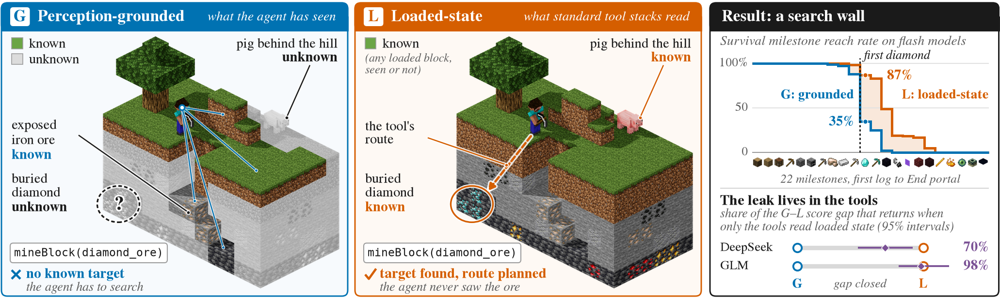

# EviCraft



EviCraft is a benchmark for evaluating Minecraft agents under **grounded evidence (G)**. Agents and
their tools reason from what the Bot observes as it explores. Run your agent on
[Survival](tasks/minecraft-survival/README.md) or [Item Discovery](tasks/minecraft-item-discovery/README.md),
or build new tasks on the same Runtime and Runner.

Companion repository for *EviCraft: Can Minecraft Agents Find What They Cannot See?*

**Contents:** [Quick start](#quick-start) · [How it works](#how-it-works) ·
[Evaluating your own Harness](#evaluating-your-own-harness) ·
[Building your own benchmark tasks](#building-your-own-benchmark-tasks) ·
[Reproducing the paper's results](#reproducing-the-papers-results) · [Documentation](#documentation)

## Requirements

- Linux, Java 21, Node.js 24 or newer, and npm. See the [Minecraft and NeoForge versions](runtime/gradle.properties).
- Python 3 for scoring.
- Xvfb and Mesa software rendering for the first-person camera. Each Attempt starts its own server JVM.
  With vision enabled, it also starts a camera JVM with a 2 GB heap and an Xvfb process.

### Host settings

Set concurrency for your host. See the [running guide](docs/running-benchmarks.md#host-settings) for
server heap, camera, and scoring settings.

## Quick start

```bash
npm ci && npm run build
npx evicraft setup --accept-eula
npx evicraft check
npx evicraft run tasks/minecraft-survival/config/quickstart/batch.yaml \
  --instance quickstart-scripted-s100-g --out runs/quickstart
npx evicraft score runs/quickstart
```

Pass `--accept-eula` if you accept the [Minecraft EULA](https://www.minecraft.net/eula).
The first setup downloads Minecraft and NeoForge and prepares the server and camera templates.

`check` runs short scenarios on real servers. The quickstart run uses the
[scripted Harness](examples/scripted-harness/README.md) on one Survival world under G for 2,400 ticks.
Both steps run without a model or GPU. Find the Attempt logs under `runs/quickstart/raw/` and
`summary.json` and `groups/G.json` under `runs/quickstart/eval/<time>/`.

## How it works

```text
Benchmark Runner ── process contract ──▶ Harness ── Runtime SDK ──▶ Runtime (Minecraft server mod)
        └──────────────── Benchmark Authority protocol ─────────▶ Runtime
```

- The **Runner** prepares the world, starts the Harness, and records the Runtime's samples for offline scoring.
- The **Harness** is the agent under test. It runs in its own process and controls the Bot over the Runtime SDK.
  [`apps/agent`](apps/agent) is the reference Harness used in the paper.
- The **Runtime** handles the Bot's observations and actions and advances game time. Under the benchmark
  settings, the world pauses while the Bot is idle, so model latency does not consume the tick budget.

| Term | Meaning |
| --- | --- |
| Task config | JSON that sets the world snapshot, knowledge profile, tick budget, camera, and Harness. |
| Batch | A `batch.yaml` listing task configs, repetitions, and concurrency. |
| Attempt | One execution of a task config with its own server, copy of the world, and Harness process. |
| Run directory | Frozen inputs, Attempt logs and samples, and evaluations written by the scorer. |

See [the run lifecycle](docs/running-benchmarks.md#run-lifecycle) for how the Runner prepares each Attempt.

## Evaluating your own Harness

1. **Connect your agent.** A Harness reads its assignment from `EVICRAFT_TASK_FILE` and controls the Bot through
   the [Harness interface](docs/harness-interface.md). Start from the
   [scripted example](examples/scripted-harness/README.md) or the [pi example](examples/pi-harness/README.md).
2. **Debug in a live G world.** Start the world, wait for `world ready`, and launch your Harness in a second
   terminal. You can restart the Harness while leaving the world open.

   ```bash
   npx evicraft world tasks/minecraft-survival \
     --config tasks/minecraft-survival/config/quickstart/scripted-s100-g.json
   npx evicraft harness -- python3 my_agent.py
   ```

3. **Run the benchmark and score it.** Use the
   [Survival G batch](tasks/minecraft-survival/config/deepseek-v4-1-flash/batch-g.yaml) or the
   [Item Discovery G batch](tasks/minecraft-item-discovery/config/deepseek-v4-1-flash/batch-g.yaml).

   ```bash
   npx evicraft run tasks/minecraft-survival/config/deepseek-v4-1-flash/batch-g.yaml \
     --concurrency 4 --out runs/my-agent -- python3 my_agent.py
   npx evicraft score runs/my-agent
   ```

   Each batch runs five Attempts on each of the ten paper worlds under G. Compare `groups/G.json` across
   Harnesses using the same task, worlds, tick budget, camera settings, repetitions, and scorer.
   The command after `--` is your Harness. If it takes settings, pass `--harness-config my-agent.json`
   before `--`. The batch retains the paper's first-person camera settings.

## Building your own benchmark tasks

A task defines what the agent should do and how its performance is measured. To vary the world, budget, or
Harness for an existing task, start with a new config for that task.

1. **Define the goal** in `tasks/<task>/task.ts`. Use `defineMinecraftTask` to set the assignment and
   revisions and reuse the shared Minecraft lifecycle.
2. **Specify the evaluation conditions** in `config/`. Choose a world snapshot, use `grounded_evidence`,
   and set the budget, camera, and Harness. Run one config first, then define the worlds and repetitions in
   a `batch.yaml`.
3. **Score the recorded observations** with your task's offline scorer. Run it directly for a new task.
   The CLI's `score` command dispatches to the bundled Survival and Item Discovery scorers.

The [task development guide](docs/benchmark-tasks.md) walks through a minimal task and scorer.

## Reproducing the paper's results

The [Survival](tasks/minecraft-survival/config/README.md#main-experiment) and
[Item Discovery](tasks/minecraft-item-discovery/config/README.md#main-experiment) model folders contain
the paper's combined `batch.yaml` and the per-profile `batch-g.yaml` and `batch-l.yaml`.
For example, point the combined DeepSeek Survival batch at your model server:

```bash
npx evicraft run tasks/minecraft-survival/config/deepseek-v4-1-flash/batch.yaml \
  --set harness.config.model.baseUrl=http://my-server:30000/v1 --concurrency 4 --out runs/survival-deepseek
npx evicraft score runs/survival-deepseek
```

Use the matching model ID and context and output limits from the batch's configs. Replace the batch path
to reproduce another model or task. The scorer writes separate G and L groups. See the
[running guide](docs/running-benchmarks.md) for model endpoints, host settings, and resuming runs.

## Documentation

| Document | Contents |
| --- | --- |
| [Harness interface](docs/harness-interface.md) | Process contract, game time, and Runtime SDK. |
| [Task development](docs/benchmark-tasks.md) | Task definitions, world configs, batches, and custom scoring. |
| [Running benchmarks](docs/running-benchmarks.md) | Setup, host settings, reference models, and run lifecycle. |
| [Minecraft Survival](tasks/minecraft-survival/README.md) | Task and 22-milestone score. |
| [Minecraft Item Discovery](tasks/minecraft-item-discovery/README.md) | Task and distinct-item score. |
| [Offline scoring](tasks/minecraft-common/eval/README.md) and [observation format](tasks/minecraft-common/observation-format.md) | Sampling, Attempt eligibility, and log encoding. |
| [World snapshots](tasks/minecraft-survival/snapshots/spawn-screening.md) | How the ten benchmark worlds were chosen and frozen. |

## Repository layout

| Path | Contents |
| --- | --- |
| `tasks/` | Task definitions, configs, snapshots, and offline scoring. |
| `apps/cli/` | The `evicraft` command and setup check. |
| `apps/agent/` | The reference Harness. |
| `packages/benchmark/` | Task API and Runner. |
| `runtime/` | NeoForge Runtime and TypeScript Runtime SDK. |
| `examples/` | Scripted and pi Harness examples. |

## Development

```bash
npm run typecheck
npm test                                  # builds the TypeScript workspace, then runs Vitest
(cd runtime && ./gradlew check)           # Java Runtime tests
npm run test:smoke                        # NeoForge smoke run
npm run test:conformance                  # NeoForge conformance scenarios
```

## Citation

The arXiv link and BibTeX entry will be added here once the paper is public.

## License

MIT, except the NeoForge mod under `runtime/` (everything there other than `runtime/sdk/` and
`runtime/camera/`), which is derived from Numen and licensed under the LGPL-3.0. See [`LICENSE`](LICENSE) and
[`runtime/THIRD_PARTY_NOTICES.md`](runtime/THIRD_PARTY_NOTICES.md).
